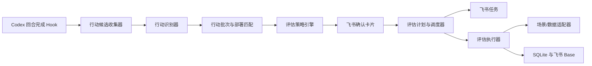

# CodexReach 通用后续评估系统设计

日期：2026-08-08
状态：已定稿

## 1. 背景与目标

许多操作不能在完成后立即判断效果，例如 SEO 修改、功能上线、性能优化和运营调整。系统需要把一次真实环境中的行动转化为可追踪的评估计划，在观察期结束后提醒用户，并由用户确认是否启动新的 Codex 评估会话。

核心闭环：

> 行动发生 → 等待观察 → 到期确认 → 执行评估 → 保存证据与结论 → 决定下一步

第一版不自动修改或回滚线上系统，也不未经确认自动运行 Codex。

## 2. 已确定的产品决策

- Codex 回合完成后自动识别可能需要后续评估的行动。
- 未部署的代码修改只在本地静默保存，生产生效后才发送草稿。
- 默认以一次生产部署或一次真实环境操作作为行动批次。
- 草稿发送到产生行动的项目群 Session 话题；无法路由时按需创建固定的“部署与评估”话题。
- 用户确认草稿后才写入正式台账、抓取业务基准并创建飞书任务。
- 所有任务进入统一的“Codex 后续评估”任务清单，默认负责人为当前用户。
- SQLite 是运行状态源；现有“Codex 项目进展追踪”Base 是业务台账。
- 到期由 CodexReach 调度器判断，飞书任务提供用户可见的待办和状态；不为每个评估建立 Codex 计划任务。
- 到期后先在原话题询问，用户确认后创建新的评估话题与 Codex Session。
- 初始草稿在第 1、3 天提醒，第 7 天归档；到期确认在第 1、3、7 天提醒，之后停止。
- 第一版模板：SEO、网站发布/功能上线、人工自定义。
- 第一版数据源：Google Search Console 与页面在线检查。
- 第一版部署源：Cloudflare Pages/Workers 与通用网页指纹。
- Google 使用 OAuth 只读授权；Cloudflare 使用本地保存的独立最小权限只读 Token。

## 3. 系统边界与模块



### 3.1 行动候选收集器

收集用户意图、Codex 结果、项目、Session、Git 状态、变更文件、提交和部署证据。候选行动未进入生产时不打扰用户。

### 3.2 行动识别器

先用规则排除查询、解释、失败构建、未采用草稿等噪声，再让模型输出固定结构的判断。建议阈值：高置信度立即发送草稿，中置信度进入候选汇总，低置信度忽略。

### 3.3 行动批次与部署匹配

同一项目、连续提交且目标范围重叠的候选行动合并等待部署。部署批次优先用平台 deployment ID 和 commit 匹配；缺失时结合部署时间、线上预期内容和网页指纹。一次部署可以在确认卡片中拆分或合并，但系统需提示同批变更难以严格归因。

### 3.4 评估策略引擎

把行动类型映射为观察节点、指标、数据来源和成功标准。业务模板只提供策略，不直接执行飞书或调度逻辑。

### 3.5 调度与任务同步

CodexReach 常驻服务周期扫描 SQLite 中到期节点，检查飞书任务状态后向原话题发送确认卡片。飞书截止时间变更同步回本地；Codex 评估完成后自动完成任务。所有外部操作通过 outbox 和幂等键保证可重试且不重复。

### 3.6 评估执行器

用户点击“开始评估”后，系统创建新的项目话题与 Codex Session，注入结构化行动、基准、版本、评估目标和约束。完整分析写入新话题，摘要回写原话题和台账。

## 4. 核心领域模型

```text
Project
└── ActionBatch
    ├── Action
    ├── Deployment
    └── EvaluationPlan
        └── EvaluationNode
            └── EvaluationRun
                ├── Evidence
                ├── Conclusion
                └── FollowUpAction
```

主要状态：

- 候选：`candidate`、`stale`、`deployed`、`abandoned`、`expired`
- 草稿：`draft_pending`、`confirmed`、`ignored`、`draft_expired`
- 评估节点：`scheduled`、`waiting_confirmation`、`running`、`postponed`、`completed`、`cancelled`、`failed`、`manual_completed`
- 结果：`effective`、`negative`、`no_material_change`、`insufficient_data`、`not_attributable`、`technical_issue`

## 5. 本地数据模型

SQLite 至少包含：

- `action_candidates`：未部署候选及来源会话。
- `action_batches`：真实环境生效的一次操作批次。
- `actions`：批次中的具体行动。
- `deployments`：平台、部署 ID、commit、部署/验证/生效时间。
- `evaluation_plans`：行动批次的整体评估策略。
- `evaluation_nodes`：每个具体到期节点、飞书任务 GUID、提醒阶段。
- `baseline_snapshots`：不可变的修改前基准与原始证据引用。
- `evaluation_runs`：每次实际评估执行。
- `project_integrations`：项目与 GSC、Cloudflare、域名的映射，不保存明文凭据。
- `topic_bindings`：项目群、原话题、“部署与评估”话题及评估话题映射。
- `outbox_events`：待发送或待重试的外部操作。

建议幂等键：

```text
action-draft:{session_id}:{turn_id}
deployment:{provider}:{resource_id}:{deployment_id}
create-task:{evaluation_node_id}
due-card:{evaluation_node_id}
reminder:{evaluation_node_id}:{stage}
start-run:{evaluation_node_id}
```

## 6. 飞书 Base 设计

保留现有 `项目清单`、`每日进展`、`对话轮次`，新增：

### 6.1 行动记录

字段包括行动 ID、项目关联、批次、行动类型、摘要、假设、影响对象、执行/生效时间、来源 Session/话题、commit、部署版本、基准摘要、识别置信度、确认状态、当前结论和本地记录 ID。

### 6.2 评估计划

每个评估节点一条记录，包括评估 ID、行动关联、项目、目标、计划时间、观察周期、指标、成功标准、数据来源、状态、飞书任务 GUID/链接、原话题、评估话题、提醒阶段和本地记录 ID。

### 6.3 评估结果

每次运行新增而不覆盖，包括结果 ID、评估计划、项目、执行时间、数据窗口、数据充分性、指标变化、证据、混杂因素、结论、置信度、建议、Session、话题和后续行动。

`项目清单`增加待确认行动数、待评估数、逾期数、最近行动/评估时间、最近结论和下一评估时间等聚合字段。

## 7. 飞书交互与路由

### 7.1 草稿

生产生效后向原 Session 话题发送批次确认卡片，提供“确认创建、调整计划、拆分/合并、无需评估”。多 Session 或外部部署无法确定原话题时，发送到项目群中按需创建的固定“部署与评估”话题。

### 7.2 任务

确认后创建任务，默认负责人为当前用户，加入统一“Codex 后续评估”清单。标题包含项目、类型和周期；描述包含行动、目标、窗口、版本及关联 ID/链接。

### 7.3 到期

任务到期后不自动运行 Codex，而是在原话题发送“开始评估、延期 7 天、选择日期、取消”卡片。开始后新建 `评估｜<对象>｜<周期>` 话题和独立 Session。

## 8. 第一版模板

### SEO

- 立即：页面、标签、状态码、canonical、robots、结构化数据和 sitemap。
- 7 天：抓取、索引和技术异常。
- 28 天：曝光、点击、CTR、平均排名；低流量时可延期至 60 天。
- 默认比较修改后完整窗口、修改前等长窗口，并参考再前一周期趋势。

### 网站发布/功能上线

- 立即：冒烟与线上可用性。
- 1 天：错误和关键流程。
- 7 天：使用、转化、反馈和稳定性。
- 第一版无自动数据适配器时提示人工补充。

### 人工自定义

用户用自然语言补充检查日期、指标、成功标准和数据来源，Codex 转成结构化计划。

## 9. 数据与部署适配器

### Google Search Console

采用用户 Google OAuth 最小只读权限。项目首次确认 GSC resource 映射；凭据仅保存在本机安全存储。基准快照不可覆盖，修正时新增版本并标记旧快照已被替代。

### 页面在线检查

保存最终 URL、状态码、重定向链、HTML/内容指纹、title、description、canonical、robots、结构化数据摘要、静态资源版本与检查时间。动态页面优先验证行动相关字段而不是只比较整页哈希。

### Cloudflare

使用独立最小权限只读 API Token，优先存入 macOS Keychain。支持 Pages/Workers 最新生产部署、状态、时间、版本和可用 commit；API 异常时降级到网页指纹。Token 不传递给 Codex Session。

## 10. 可靠性、安全与异常

- SQLite 事务、执行锁、outbox、唯一索引和幂等键防止重复。
- 服务启动执行补偿扫描；错过多个提醒时只发送当前阶段一次。
- 外部 API 使用限次、缓存、指数退避和脱敏日志。
- 所有 OAuth/Token 只存本机安全位置，不写入 Base、飞书、Git、普通日志或 Codex 提示。
- 飞书任务被人工完成时停止提醒但不伪造评估结论；任务丢失进入异常状态。
- 后续部署影响相同范围时提示重置窗口、合并、继续但标记混杂或取消。
- 数据不足不判断有效性，完成当前节点并在用户确认后创建延期节点。

## 11. 第一版非目标

- 自动修改、发布或回滚线上系统。
- 未经确认自动启动评估。
- GA4、PostHog、广告平台、Vercel、GitHub Actions。
- 严格因果推断或依据单日波动作结论。
- 多用户复杂权限和自动学习永久规则。

## 12. 端到端验收

以 `classgames.net` 为示例：Codex 修改 SEO 但未部署时飞书无草稿；Cloudflare 生产部署并验证后，原话题出现草稿；用户确认后 Base 产生行动和评估计划、GSC 基准保存、两项飞书任务进入统一清单；模拟到期后原话题询问；用户开始后生成独立评估 Session；结果写回三处并完成任务；重复 Hook、部署事件和按钮点击均不产生重复记录。
